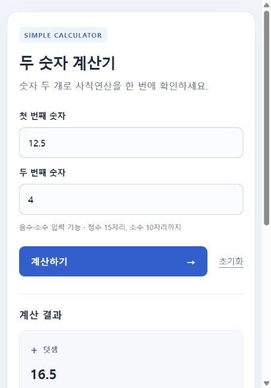

# 두 숫자 계산기

두 숫자를 입력하면 덧셈·뺄셈·곱셈·나눗셈 결과를 한 번에 보여주는 간단한 웹 앱입니다.
백엔드는 Python과 FastAPI, 화면은 HTML·CSS로 구성했습니다.

## 기능 요약

- 숫자 입력칸 2개, 계산하기 버튼, 초기화 링크
- 네 가지 연산 결과를 각각 카드로 표시
- 정수·음수·소수 지원, 계산 후 입력값 유지
- 빈 입력과 잘못된 숫자에 대한 한국어 오류 안내
- 두 번째 숫자가 0이면 나눗셈 카드에 안내 문구 표시, 나머지 연산은 정상 처리
- 작은 화면에서는 입력칸과 결과 카드를 한 줄씩 배치
- 외부 글꼴이나 JavaScript 없이 동작

## 현재 작업 환경에서 바로 실행

프로젝트 전용 가상환경에 필요한 패키지 설치와 테스트를 완료했습니다.
PowerShell에서 다음 명령을 실행하세요. 이미 서버가 실행 중이면 아래 주소에 바로 접속하면 됩니다.

```powershell
cd C:\AIO4\calculator
.\.venv\Scripts\python.exe -m uvicorn main:app --reload --host 127.0.0.1 --port 8000
```

브라우저에서 [계산기 열기](http://127.0.0.1:8000)에 접속합니다.
서버를 종료하려면 실행한 터미널에서 `Ctrl+C`를 누릅니다.

## 새 환경에서 설치 및 실행

Python 3.10 이상이 필요합니다. 검증에 사용한 버전은 Python 3.12.14입니다.
Python이 없다면 [Python 공식 다운로드](https://www.python.org/downloads/)에서 설치하고 터미널을 다시 여세요.
Windows에서는 설치 시 Python launcher 또는 PATH 옵션을 활성화하세요.

### Windows PowerShell

```powershell
cd C:\AIO4\calculator
py -m venv .venv
.\.venv\Scripts\python.exe -m pip install -r requirements.txt
.\.venv\Scripts\python.exe -m uvicorn main:app --reload --host 127.0.0.1 --port 8000
```

`py` 명령이 없고 `python`이 설치되어 있다면 첫 명령을 `python -m venv .venv`로 바꾸세요.
가상환경의 Python을 직접 호출하므로 PowerShell 실행 정책을 변경하거나 활성화 스크립트를 실행할 필요가 없습니다.

`uv`가 설치된 환경에서는 아래 명령도 사용할 수 있습니다.

```powershell
uv venv .venv --python 3.12
uv pip install --python .venv\Scripts\python.exe -r requirements-dev.txt
.\.venv\Scripts\python.exe -m uvicorn main:app --reload
```

### macOS / Linux

```bash
cd /path/to/calculator
python3 -m venv .venv
.venv/bin/python -m pip install -r requirements.txt
.venv/bin/python -m uvicorn main:app --reload --host 127.0.0.1 --port 8000
```

## 사용 예시

1. 첫 번째 숫자에 `12.5`를 입력합니다.
2. 두 번째 숫자에 `4`를 입력합니다.
3. **계산하기**를 클릭하거나 입력칸에서 Enter를 누릅니다.

| 연산 | 결과 |
| --- | --- |
| 덧셈 | 16.5 |
| 뺄셈 | 8.5 |
| 곱셈 | 50 |
| 나눗셈 | 3.125 |

뺄셈과 나눗셈의 순서는 **첫 번째 숫자 − 또는 ÷ 두 번째 숫자**입니다.
**초기화**를 누르면 입력값과 결과가 지워집니다.



## 파일 구성과 역할

```text
calculator/
├── main.py                 # FastAPI 경로, 입력 검증, Decimal 계산
├── templates/
│   └── index.html          # Jinja2 HTML 화면
├── static/
│   └── style.css           # 화면 스타일과 반응형 배치
├── tests/
│   └── test_app.py         # 자동 검증
├── requirements.txt        # 실행 패키지
├── requirements-dev.txt    # 실행 패키지 + 테스트용 httpx
├── preview.png             # 실제 브라우저 화면 캡처
└── README.md
```

## 동작 설명

1. `GET /` 요청 시 FastAPI가 빈 계산기 화면을 렌더링합니다.
2. HTML 폼은 `first`, `second` 값을 `POST /calculate`로 보냅니다.
3. `parse_number()`가 입력 형식과 길이를 검사하고 `Decimal`로 변환합니다.
4. `calculate()`가 네 가지 연산을 수행합니다.
5. Jinja2 템플릿에 입력값과 결과를 전달해 새 화면을 반환합니다.
6. CSS는 `GET /static/style.css`에서 제공합니다.

정상 계산은 HTTP 200, 잘못된 입력은 오류 안내 화면과 HTTP 400을 반환합니다.
0으로 나누기는 처리 가능한 계산 상황으로 보고 HTTP 200과 안내 문구를 반환합니다.
HTML 템플릿의 기본 이스케이프 처리로 입력한 HTML 태그를 실행하지 않습니다.

## 숫자 처리 기준

- 정수 부분은 최대 15자리, 소수 부분은 최대 10자리입니다. 부호는 자릿수에서 제외합니다.
- `-12.5`, `+3`, `.5` 형식을 허용하며 앞뒤 공백은 제거합니다.
- 쉼표, 지수 표기(`1e3`), 문자, `NaN`, `Infinity`는 허용하지 않습니다.
- `Decimal`을 사용하므로 `0.1 + 0.2`는 `0.3`으로 표시됩니다.
- 덧셈·뺄셈·곱셈은 허용 범위 안에서 계산된 값을 소수 자릿수 손실 없이 표시합니다.
- 나눗셈은 소수점 아래 10자리에서 반올림합니다. 정확히 중간인 경우 짝수 방향으로 반올림하는 Decimal 기본 규칙(`ROUND_HALF_EVEN`)을 사용합니다.
- 결과에서 불필요한 소수점 뒤 0을 제거하고 음의 0은 `0`으로 표시합니다.

## 오류 검증

테스트 패키지를 설치한 뒤 프로젝트 폴더에서 실행합니다.

```powershell
.\.venv\Scripts\python.exe -m pip install -r requirements-dev.txt
.\.venv\Scripts\python.exe -m unittest discover -s tests -v
```

현재 제공된 가상환경은 `uv`로 설치했으므로 pip가 없을 수 있습니다. 이 경우 설치 명령 대신 다음을 사용하세요.

```powershell
uv pip install --python .venv\Scripts\python.exe -r requirements-dev.txt
```

검증 결과: **10개 테스트 통과**. 잘못된 입력은 여러 값과 두 입력칸을 조합해 추가 검증합니다.

| 검증 항목 | 결과 |
| --- | --- |
| 초기 화면과 CSS 응답 | 통과 |
| 네 가지 연산 결과 | 통과 |
| 소수 계산 정밀도 | 통과 |
| 음수·공백·소수점으로 시작하는 입력 | 통과 |
| 0과 음의 0으로 나누기 | 통과 |
| 빈 입력·문자·특수값·허용 자릿수 초과 | 통과 |
| 폼 필드 누락 | 통과 |
| 순환소수 반올림 | 통과 |
| 입력 범위 경계의 곱셈·나눗셈 | 통과 |
| 입력 HTML 이스케이프 처리 | 통과 |

실제 Uvicorn 서버와 브라우저에서도 `12.5`, `4`를 입력해 네 결과가 표시되는 것을 확인했습니다.
검증 환경의 주요 패키지는 FastAPI 0.150.0, Uvicorn 0.54.0, Jinja2 3.1.6,
python-multipart 0.0.32, httpx 0.28.1입니다.
현재 Starlette에서 httpx 기반 테스트 클라이언트에 대한 사용 중단 예정 경고가 출력되지만,
이번 테스트는 모두 통과했습니다. 모든 실행 환경과 입력에 대한 무오류를 보장하는 의미는 아닙니다.

## 문제 해결

- **`python` 또는 `py` 명령을 찾을 수 없음:** Python을 설치하고 새 터미널에서 확인하세요. 현재 환경에서는 위의 가상환경 Python을 바로 사용할 수 있습니다.
- **`No module named fastapi` 등:** 프로젝트 가상환경을 대상으로 의존성을 설치했는지 확인하세요.
- **8000 포트 사용 중:** 이미 실행한 계산기에 접속하거나 `--port 8001`로 실행하고 `http://127.0.0.1:8001`에 접속하세요.
- **HTML 파일만 열면 계산되지 않음:** FastAPI 서버를 실행한 뒤 서버 주소로 접속해야 합니다.
- **나눗셈 결과가 0으로 표시됨:** 절댓값이 매우 작은 결과는 소수점 아래 10자리 반올림으로 0이 될 수 있습니다.

`--reload`는 코드 변경 시 서버를 자동 재시작하는 개발용 옵션입니다.
이 예제는 로컬에서 사용하는 계산기이며 입력값을 데이터베이스나 파일에 저장하지 않습니다.

## 참고 문서

- [FastAPI HTML 템플릿](https://fastapi.tiangolo.com/advanced/templates/)
- [FastAPI 폼 데이터](https://fastapi.tiangolo.com/tutorial/request-forms/)
